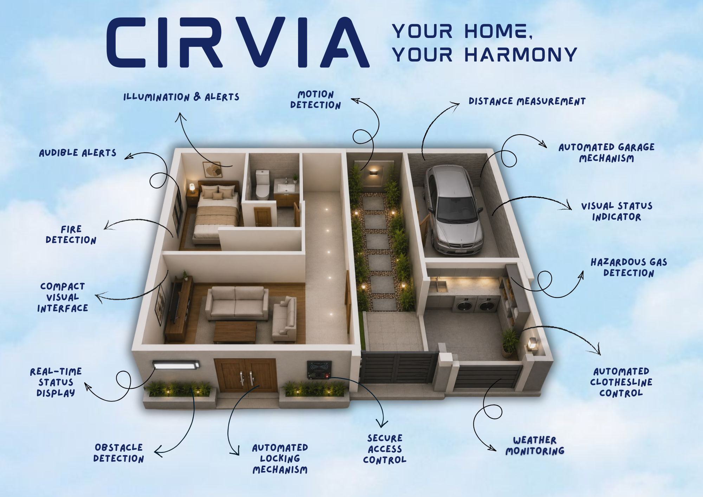
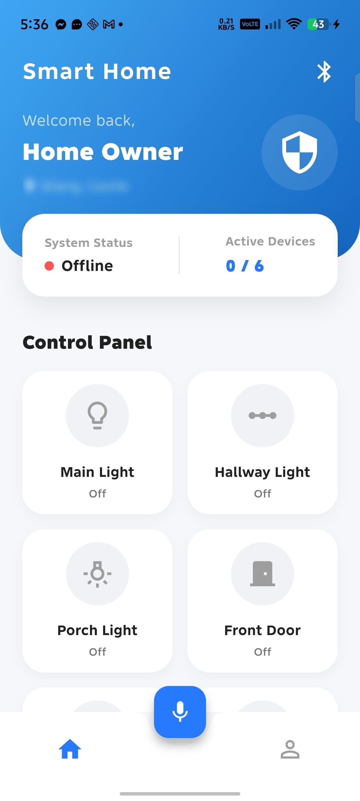
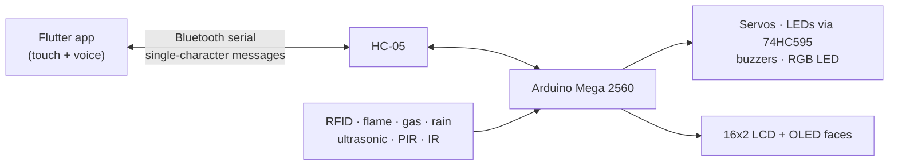

# Cirvia

**Your home, your harmony.** A smart home prototype built on an Arduino Mega, controlled from a Flutter mobile app by touch or by voice.

Cirvia combines security, safety, and comfort in a scale-model house: RFID door access, fire and gas detection, a roof that closes automatically when it rains, a garage door that opens for an approaching car, motion-activated lights, and an OLED "assistant" with facial expressions. The companion app talks to the house over Bluetooth, announces events out loud, and raises emergency alerts with a siren.


<p align="center">
  
</p>

---

## Features

| Area | What it does |
|---|---|
| 🔐 **Secure access** | An RFID reader opens the double front door for an authorized card and turns on the welcome lights. Unknown cards trigger a security alert with a siren in the app. |
| 🔥 **Fire detection** | A flame sensor sounds the buzzer, switches on every main light, and **opens the front door for evacuation**. The app shows a full-screen emergency alert. |
| 💨 **Gas detection** | A gas sensor sounds a separate buzzer, turns the RGB indicator red, and alerts the app. |
| 🌧️ **Smart roof** | A rain sensor closes the clothesline roof automatically. The app refuses to reopen it while it is still raining. |
| 🚗 **Automatic garage** | An ultrasonic sensor opens the garage when a car approaches. A **safety interlock** blocks closing the door, by tap or by voice, while a car is detected. |
| 🚶 **Motion lighting** | A PIR sensor lights the hallway; an IR sensor at the porch turns on the porch lights and notifies the app. |
| 🙂 **OLED assistant** | A 128×64 OLED shows faces (neutral, happy, angry, emergency) while a 16×2 LCD shows the system status. |
| 🎙️ **Voice control** | Commands such as *"main lights on"*, *"open the door"*, or *"activate clothes"* are recognized in the app, and every action is confirmed with text-to-speech. |

## The mobile app

<p align="center">
  
</p>

- Connects to the house over Bluetooth Classic (it picks the paired **HC-05** automatically)
- Control panel for lights, front door, smart roof, and garage, with an active-device counter
- Large on-screen notifications plus spoken feedback for every event
- Full-screen fire and gas alerts with a siren
- Voice commands through the microphone button

---

## How it works



The app and the board exchange **single-character messages** at 9600 baud.

### App → Arduino (commands)

| Command | Action |
|---|---|
| `2` / `3` | Main lights on / off |
| `4` / `5` | Hallway lights on / off |
| `1` / `0` | Porch lights on / off |
| `O` / `C` | Open / close the front door |
| `8` / `9` | Close the roof manually / return the roof to automatic mode |
| `X` / `Y` | Open the garage manually / return the garage to automatic mode |
| `W` / `A` | OLED assistant: wake up (happy face) / angry face |

### Arduino → App (events)

| Event | Meaning |
|---|---|
| `K` / `L` | Authorized RFID card: door opened / door closed again |
| `Z` | Unauthorized RFID card |
| `I` | Motion detected at the porch |
| `F` | Fire detected |
| `G` | Gas leak detected |
| `S` | Alarm cleared, back to standby |
| `R` / `D` | Rain detected (roof closed) / dry again (roof opened) |
| `U` / `V` | Car detected (garage opening) / car gone (garage closing) |

---

## Hardware

| Component | Arduino Mega pins |
|---|---|
| HC-05 Bluetooth module | Serial1 (TX1 18, RX1 19) |
| MFRC522 RFID reader | SPI (50–53), SS 8, RST 5 |
| 16×2 I2C LCD (0x27) and SH1106 128×64 I2C OLED (0x3C) | I2C (SDA 20, SCL 21) |
| 2 × 74HC595 shift registers (main and hallway LEDs) | Latch/clock/data 23/22/24 and 26/25/27 |
| Front door servos (double door) | 6, 7 |
| Roof servo | 9 |
| Garage servo | 10 |
| HC-SR04 ultrasonic sensor | Trig 30, Echo 31 |
| Flame sensor + fire buzzer | A2, buzzer 28 |
| Gas sensor (MQ series) + gas buzzer | A0, buzzer 29 |
| Rain sensor | A1 |
| PIR motion sensor | 11 |
| IR obstacle sensor (porch) | 33 |
| RGB status LED | R 46, G 45, B 44 |
| Porch and side LEDs | 37, 35, 34 |

---

## Getting started

### Firmware

1. Open `firmware/cirvia_firmware/cirvia_firmware.ino` in the Arduino IDE.
2. Install these libraries from the Library Manager: **MFRC522**, **LiquidCrystal I2C**, **Servo**, **Adafruit GFX Library**, and **Adafruit SH110X**.
3. Set `authorizedUID` to your own RFID card. To read a card's UID, upload the MFRC522 library's **DumpInfo** example and scan the card while the Serial Monitor is open.
4. Select **Arduino Mega or Mega 2560** and upload.
5. Tune the thresholds at the top of the sketch (`rainThreshold`, `gasThreshold`, `distanceThreshold`) to your sensors.

### App

Requires the [Flutter SDK](https://docs.flutter.dev/get-started/install) and an Android phone with Bluetooth.

```bash
cd app
flutter pub get
flutter run
```

Pair the phone with the HC-05 in Android's Bluetooth settings first (the default PIN is usually `1234`), then tap the Bluetooth icon in the app to connect.

---

## Project structure

```
app/                      Flutter app (UI, Bluetooth, voice commands, text-to-speech)
  lib/main.dart
  assets/sounds/siren.wav
firmware/cirvia_firmware/ Arduino Mega sketch
docs/                     Poster and screenshots
```

## License

[MIT](LICENSE) © 2026 Joshua Buiza
